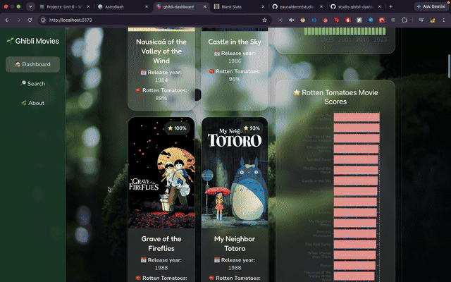

# *Studio Ghibli Movie Dashboard 🌱*

# Web Development Project 6 - Studio Ghibli Movie Dashboard 🌱

Submitted by: **Ana Calderón**

This web app: **A Studio Ghibli Movie Dashboard built with React that fetches movie data from the Studio Ghibli API. Users can search movies by title, filter movies by release year, view movie information and Rotten Tomatoes scores, explore summary statistics that update dynamically, and interact with data visualizations. Users can also navigate to individual movie detail pages, a dedicated Search page, and an About page.**

Time spent: **[Update with your total hours spent on Project 6]**

## Required Features

The following **required** functionality is completed:

- [x] **Dashboard displays data from an API**
  - [x] Displays Studio Ghibli movies fetched from the Studio Ghibli API.
  - [x] Displays multiple movies, with information such as title, release year, poster, and Rotten Tomatoes score.
  - [x] Each movie card displays at least two pieces of information about the movie.

- [x] **Uses `useEffect` and `async/await`**
  - [x] Uses `useEffect` to fetch movie data when the component loads.
  - [x] Uses `async/await` and `fetch()` to retrieve data from the API.
  - [x] Includes loading and error handling.

- [x] **Dashboard includes at least three summary statistics**
  - [x] Displays the number of movies currently shown.
  - [x] Displays the average Rotten Tomatoes score.
  - [x] Displays the highest Rotten Tomatoes score.
  - [x] Updates the statistics based on the filtered movies.

- [x] **Search bar**
  - [x] Allows users to search for movies by title.
  - [x] Updates the displayed movies as the search changes.

- [x] **At least one additional filter**
  - [x] Includes a release-year slider to filter movies by year.
  - [x] Allows users to combine the release-year filter with the title search.

- [x] **Interactive movie detail pages**
  - [x] Clicking a movie card opens a dedicated detail page.
  - [x] Each movie has a unique URL.
  - [x] Detail pages display additional information about the selected movie.

- [x] **Data visualizations**
  - [x] Includes two different charts built with Recharts.
  - [x] Displays the number of movies released in each year.
  - [x] Displays movie Rotten Tomatoes scores for comparison.
  - [x] Uses movie data fetched from the Studio Ghibli API.

## Optional Features

The following **optional** features are implemented:

- [x] **Multiple filters**
  - [x] Users can combine the title search and release-year filter.

- [x] **Different input types**
  - [x] Uses a text input for searching and a slider for filtering by release year.

- [ ] **Specific bounds for filters**
  - [ ] Add explicit minimum and maximum bounds to the filter, if required by the rubric.

## Additional Features

- [x] Displays movie posters and Rotten Tomatoes score badges.
- [x] Shows a message when no movies match the selected search and filter criteria.
- [x] Includes loading and error messages when fetching movie data.
- [x] Uses a Studio Ghibli-inspired background image.
- [x] Uses Google Fonts: Fredoka and Nunito.
- [x] Features translucent, glass-style cards.
- [x] Includes hover effects and responsive CSS styling.
- [x] Uses a custom color palette and playful visual details inspired by Studio Ghibli.
- [x] Includes sidebar navigation for the Dashboard, Search, and About pages.
- [x] Includes a dedicated Search page with clickable movie results.
- [x] Includes an About page describing the project.
- [x] Includes a custom 404 page for invalid routes.
- [x] Uses React Router for page navigation and individual movie URLs.
- [x] Displays two movie cards per row alongside the data visualizations on larger screens.

## Video Walkthrough

Here's a walkthrough of implemented features:

## Notes

One challenge I encountered was working with the filtering logic and calculating summary statistics, especially making sure the search bar and release-year slider worked together correctly. I also had to keep track of adding the correct CSS class names throughout my JSX so I could style each part of the dashboard the way I wanted. I spent a lot of time refining the CSS to achieve the Studio Ghibli-inspired design and make the layout consistent across the different pages. Another challenge was implementing React Router so that each movie had its own detail page and unique URL. I also spent about two hours troubleshooting my demo GIF because it wasn't working as expected.

## Technologies Used

- React
- Vite
- JavaScript
- CSS
- React Router
- Recharts
- Studio Ghibli API

## License

Copyright 2026 Ana Calderon

Licensed under the Apache License, Version 2.0 (the "License"); you may not use this file except in compliance with the License. You may obtain a copy of the License at:

[http://www.apache.org/licenses/LICENSE-2.0](http://www.apache.org/licenses/LICENSE-2.0)

Unless required by applicable law or agreed to in writing, software distributed under the License is distributed on an "AS IS" BASIS, WITHOUT WARRANTIES OR CONDITIONS OF ANY KIND, either express or implied. See the License for the specific language governing permissions and limitations under the License.
